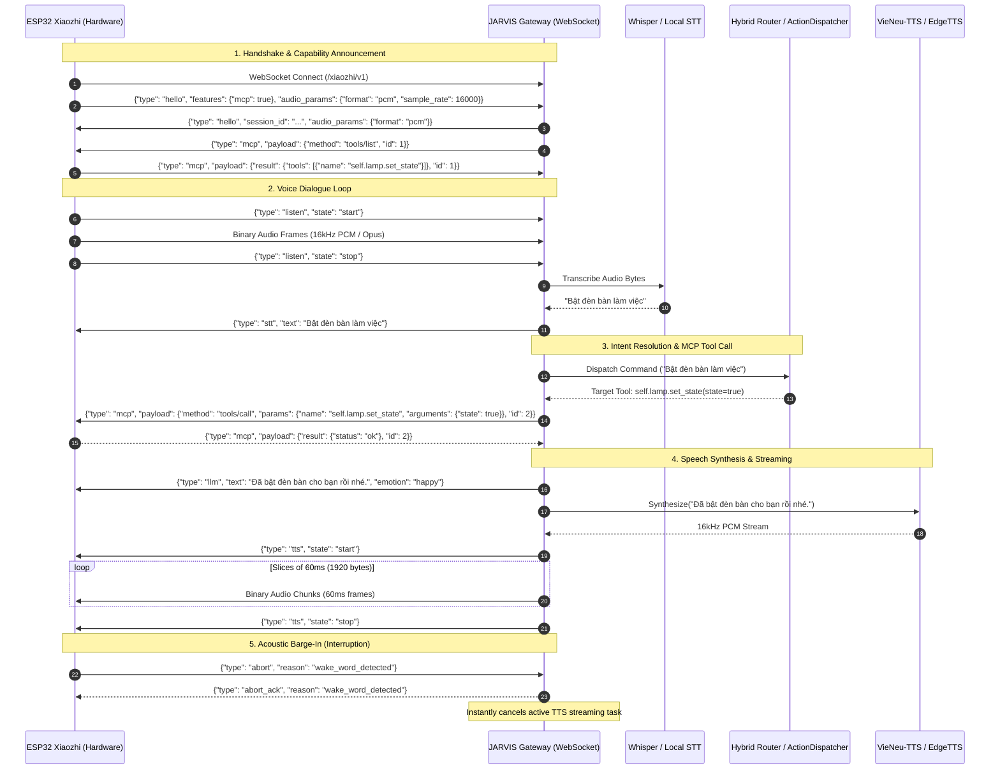

# Xiaozhi-ESP32 Hardware Companion & Model Context Protocol (MCP) Integration Guide

## 1. Kiến Trúc & Tổng Quan Hệ Thống

Dự án **Xiaozhi-ESP32** ([78/xiaozhi-esp32](https://github.com/78/xiaozhi-esp32)) là một chatbot AI phần cứng mã nguồn mở chạy trên vi điều khiển ESP32 (đặc biệt là ESP32-S3 với microphone MEMS, loa I2S và màn hình LCD/OLED). 

Trong hệ sinh thái **JARVIS**, module `XiaozhiGatewayServer` (`jarvis/comms/xiaozhi_gateway.py`) đóng vai trò là một **Local Edge AI Gateway & Hardware Bridge**:
- Cho phép mọi thiết bị phần cứng ESP32 Xiaozhi trong mạng nội bộ (LAN / Wi-Fi) hoặc internet kết nối trực tiếp đến JARVIS sovereign desktop assistant qua kết nối WebSocket song công thời gian thực (Full-Duplex WebSocket).
- Sử dụng **Model Context Protocol (MCP)** hai chiều:
  1. **Server-to-Device**: JARVIS phát hiện và kích hoạt các năng lực phần cứng cục bộ trên ESP32 (bật/tắt đèn bàn qua GPIO, hiển thị text/emoji lên màn hình OLED, đo nhiệt độ/độ ẩm từ cảm biến DHT22/SHT30).
  2. **Device-to-Server**: Thiết bị ESP32 kích hoạt các hành động mạnh mẽ trên PC thông qua JARVIS `ActionDispatcher` (điều chỉnh âm lượng Windows, mở ứng dụng, tìm kiếm thông tin, quản lý lịch làm việc, điều khiển nhà thông minh qua Home Assistant).



---

## 2. Thông Số Kỹ Thuật Giao Thức (Protocol Specification)

### 2.1. Handshake (`hello`)
Ngay khi kết nối WebSocket được mở, ESP32 gửi thông điệp `hello`:
```json
{
  "type": "hello",
  "version": 1,
  "features": {
    "mcp": true,
    "aec": true
  },
  "transport": "websocket",
  "audio_params": {
    "format": "pcm",
    "sample_rate": 16000,
    "channels": 1,
    "frame_duration": 60
  }
}
```
Phản hồi từ JARVIS Gateway:
```json
{
  "type": "hello",
  "transport": "websocket",
  "session_id": "8a3cf134-4b51-4682-90ab-1b86e0828290",
  "audio_params": {
    "format": "pcm",
    "sample_rate": 16000,
    "channels": 1,
    "frame_duration": 60
  }
}
```

### 2.2. Ghi Âm & Luồng Âm Thanh (`listen`)
- Bắt đầu thu âm (khi người dùng bấm nút hoặc wake-word được nhận diện):
  `{"type": "listen", "state": "start", "mode": "auto"}`
- Dữ liệu âm thanh: Gửi dưới dạng binary WebSocket frames (khung 60ms = 960 mẫu = 1920 byte PCM 16-bit mono 16kHz).
- Kết thúc thu âm:
  `{"type": "listen", "state": "stop"}`

### 2.3. Ngắt Lời Thời Gian Thực (`abort` / Barge-in)
Nếu người dùng ngắt lời hoặc phát hiện từ khóa đánh thức trong lúc loa ESP32 đang phát âm thanh TTS:
```json
{
  "type": "abort",
  "reason": "wake_word_detected"
}
```
Gateway sẽ ngay lập tức hủy bỏ task stream âm thanh (`active_tts_task.cancel()`), xả sạch buffer và trả về phản hồi:
```json
{
  "type": "abort_ack",
  "reason": "wake_word_detected"
}
```

### 2.4. Model Context Protocol (MCP JSON-RPC 2.0)
Tất cả các lệnh MCP được bọc trong envelope `"type": "mcp"` với chuẩn JSON-RPC 2.0:
- **Khám phá công cụ (`tools/list`)**:
  ```json
  {
    "session_id": "...",
    "type": "mcp",
    "payload": {
      "jsonrpc": "2.0",
      "method": "tools/list",
      "params": {},
      "id": 1
    }
  }
  ```
- **Kích hoạt công cụ (`tools/call`)**:
  ```json
  {
    "session_id": "...",
    "type": "mcp",
    "payload": {
      "jsonrpc": "2.0",
      "method": "tools/call",
      "params": {
        "name": "self.lamp.set_state",
        "arguments": { "state": true }
      },
      "id": 2
    }
  }
  ```

---

## 3. Cấu Hình & Khởi Chạy

### 3.1. Cấu hình trong `config/default_config.yaml`
```yaml
comms:
  xiaozhi:
    enabled: true
    host: "0.0.0.0"
    port: 8088
    path: "/xiaozhi/v1"
    auth_token: ""               # Tùy chọn token Bearer bảo mật cho phần cứng
    audio_format: "pcm"          # "pcm" hoặc "opus"
    sample_rate: 16000           # 16000 Hz
    frame_duration_ms: 60        # 60ms mỗi frame chuẩn ESP32
    enable_mcp: true             # Kích hoạt bắc cầu MCP hai chiều
    tts_voice: "vieneu"          # Engine giọng nói: "vieneu" hoặc "edge"
    rate_limit:
      requests_per_minute: 60
      burst_limit: 10
```

### 3.2. Chạy Gateway Độc Lập qua CLI
```powershell
python -m jarvis.cli xiaozhi --host 0.0.0.0 --port 8088
```

### 3.3. Tự Động Chạy Cùng JARVIS App
Khi khởi động JARVIS (`python -m jarvis.cli run`), `JarvisApp` sẽ tự động khởi tạo và lắng nghe trên port 8088. Mọi thiết bị ESP32 Xiaozhi trong nhà chỉ cần trỏ địa chỉ WebSocket server tới:
```
ws://<IP_MAY_TINH_JARVIS>:8088/xiaozhi/v1
```

---

## 4. Kiểm Thử & Xác Nhận Chất Lượng (Quality Gates)

Suite kiểm thử toàn diện được thực thi tự động tại `tests/unit/test_xiaozhi_gateway.py`:
- `test_gateway_config_and_defaults`: Kiểm tra toàn bộ tham số mặc định.
- `test_device_registry_atomic_persistence`: Kiểm tra chuẩn ghi đĩa nguyên tử trên Windows (`_save_lock`, retry backoff cho `WinError 5`).
- `test_session_lifecycle_and_barge_in`: Kiểm tra cỗ máy trạng thái và ngắt lời.
- `test_mcp_bridge_tools_list_and_call`: Kiểm tra xuất danh sách MCP tools từ ActionDispatcher và gọi hàm.
- `test_websocket_handshake_and_mcp_discovery`: Kiểm tra bắt tay WebSocket end-to-end.
- `test_websocket_auth_failure_fail_closed`: Kiểm tra fail-closed 401 khi sai token.
- `test_websocket_rate_limiting_fail_closed`: Kiểm tra rate limiting theo chuẩn token-bucket.
- `test_websocket_listen_speech_tts_loop`: Kiểm tra toàn bộ chu trình thoại voice.
- `test_websocket_barge_in_abort_cancellation`: Kiểm tra huỷ stream TTS tức thì khi nhận `abort`.
- `test_device_mcp_tool_invocation_and_timeout`: Kiểm tra gọi công cụ trên phần cứng và timeout fail-closed.
- `test_malformed_json_resilience`: Kiểm tra cô lập lỗi dữ liệu JSON hỏng.

**Kết quả kiểm thử thực tế**: 11/11 tests PASS (100%).
